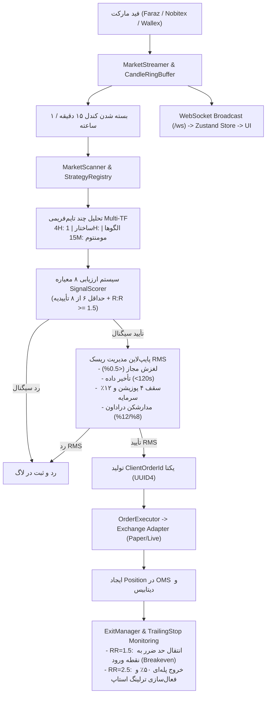

# راهنمای جامع معماری، چرخه حیات و توسعه سامانه معامله‌گر الگوریتمی (AlgoTrade)
> **نسخه:** ۱.۰.۰ | **وضعیت پایدار:** تمامی ۱۲۲ تست بک‌اند و تست‌های فرانت‌اند پاس شده‌اند | **محیط پیش‌فرض:** Paper Trading (شبیه‌ساز بدون ریسک)

---

## ۱. نمای کلی سیستم و فلسفه معماری (System Overview)

پروژه **AlgoTrade** یک پلتفرم معامله‌گری الگوریتمی ماژولار، با عملکرد بالا، ایمن و قابل بکتست است که برای بازارهای کریپتوکارنسی (Crypto)، فارکس (Forex) و بورس تهران (TSE) طراحی شده است. معماری سیستم بر اساس اصول **Domain-Driven Design (DDD)** و اصل **مسئولیت منفرد (Single Responsibility Principle - SRP)** به لایه‌های کاملاً تفکیک‌شده تقسیم شده است.

### ساختار کلی درخت پروژه:
```
AlgoTrade/
├── backend/                  # هسته پردازشی، تحلیل بازار، ریسک، ربات و API (FastAPI)
│   ├── app/
│   │   ├── ai_agent/         # دستیار هوشمند تریدینگ چندپرسونایی (LLM + Fallback)
│   │   ├── ai_optimizer/     # موتور داده‌کاوی الگوها (Pattern Miner) و بهینه‌ساز پارامترها
│   │   ├── api/              # مسیرهای REST API و وب‌سوکت دوطرفه (/ws)
│   │   ├── backtest/         # موتور بکتست بدون سوگیری آینده با شبیه‌سازی کارمزد/اسلیپیج
│   │   ├── bot/              # ارسال هشدار به تلگرام و پیام‌رسان بله
│   │   ├── config/           # تنظیمات یکپارچه بر پایه متغیرهای محیطی Pydantic BaseSettings
│   │   ├── db/               # لایه پایگاه‌داده غیرهمزمان SQLAlchemy و ریپازیتوری‌ها
│   │   ├── exchange/         # الگوهای آداپتور صرافی‌ها (Paper, Nobitex, Wallex, Faraz)
│   │   ├── indicators/       # توابع خالص محاسباتی (RSI, ATR, Volume, Risk/Reward)
│   │   ├── market_data/      # فید قیمت، بافر حلقوی، تحلیل مولتی‌تایم‌فریم و اسکنر
│   │   ├── models/           # مدل‌های داده‌ای Pydantic و جداول دیتابیس
│   │   ├── oms/              # سیستم مدیریت سفارشات (Order Management System)
│   │   ├── risk/             # سیستم کنترل و مدیریت ریسک پیش‌معامله (Pre-Trade RMS)
│   │   ├── scheduler/        # زمان‌بندی جاب‌ها (اسکن هر ۱۵ دقیقه بعد از بسته شدن کندل)
│   │   └── strategy/         # تحلیل ساختار (HH/HL, BOS, CHoCH)، الگوها و امتیازدهی ۸ معیاره
│   ├── config/patterns/      # قوانین جامع الگوهای قیمتی در قالب فایل‌های YAML
│   ├── requirements.txt      # وابستگی‌های پایتون ۳.۱۲+
│   └── tests/                # ۱۲۲ تست خودکار پوشش‌دهنده کل منطق معاملاتی
├── frontend/                 # داشبورد تحت وب SPA (React 18 + Vite + TypeScript + Tailwind)
│   └── src/
│       ├── components/       # چارت‌های تریدینگ‌ویو، اسکنر، کامپوننت‌های مشترک
│       ├── pages/            # صفحات تریدینگ، دستیار هوش مصنوعی، اسکنر، بکتست، تنظیمات
│       ├── stores/           # مدیریت وضعیت واکنش‌گرا با Zustand
│       └── i18n/             # چندزبانه (فارسی RTL و انگلیسی)
└── docs/                     # مستندات فنی و راهنمای یکپارچه‌سازی ماژول‌ها
```

---

## ۲. چرخه حیات و جریان داده‌ها در سیستم (Execution Dataflow)

کل چرخه پردازش از لحظه ورود کندل تا ثبت پوزیشن به صورت زیر جریان می‌یابد:



---

## ۳. تحلیل عمیق دامنه‌های تخصصی سیستم (Core Domains Deep-Dive)

### ۳.۱. داده‌های بازار و استریمر زنده (`app/market_data/`)
* **`CandleRingBuffer`**: بافر حلقوی در حافظه با سقف ۱۰۰۰ کندل آخر برای هر نماد و تایم‌فریم، که مانع از هرگونه نشت حافظه (Memory Leak) می‌شود.
* **`MultiTimeframeManager`**: فراهم‌کننده همگام‌سازی آرایه‌های کندلی بسته شده برای تایم‌فریم‌های 4H, 1H, 15M بدون نگاه به آینده (No Look-ahead bias).
* **`MarketStreamer`**: موتور پس‌زمینه که فقدان وب‌سوکت در فیدهای محلی را با پولینگ هوشمند و توزیع لحظه‌ای روی وب‌سوکت `/ws` جبران می‌کند.
* **اسکن ۱۵ دقیقه‌ای**: مطابق بند ۵.۵ فایل استانداردهای معماری، تحلیل استراتژی‌ها فقط در پایان بسته شدن کندل انجام می‌شود و هرگز در میانه کندل اجرا نمی‌شود.

### ۳.۲. موتور استراتژی و سیستم امتیازدهی ۸ معیاره (`app/strategy/`)
سیگنال ورود تنها زمانی معتبر شناخته می‌شود که حداقل **۶ معیار از ۸ معیار** زیر تأیید شوند:
1. **ساختار تایم‌فریم ۴ ساعته (4H Structure)**: روند صعودی با سقف‌ها و کف‌های بالاتر (HH/HL) یا شکست ساختار (BOS/CHoCH).
2. **موقعیت مناسب قیمت (Location)**: قرارگیری در سطوح حمایت/مقاومت، اوردربلاک (Order Block) یا عدم تعادل نقدینگی (FVG).
3. **الگوی کندلی ۱ ساعته (1H Entry Pattern)**: الگوهای Bullish Engulfing, Pin Bar, Hammer یا Morning Star.
4. **تأییدیه مومنتوم ۱۵ دقیقه‌ای (15M Momentum)**: تلاقی شتاب و حجم در جهت معامله.
5. **تأییدیه اندیکاتور RSI(14)**: قرار داشتن در محدوده نرمال قدرت روند (۴۰ تا ۷۰ برای لانگ).
6. **تأییدیه حجم معامله (Volume)**: حجم کندل تاییدیه بالاتر از میانگین متحرک ۱۰ دوره‌ای `Volume > MA(10)`.
7. **نسبت ریسک به ریوارد (Risk/Reward)**: نسبت حداقل ۱:۱.۵ تا اولین تارگت.
8. **حد ضرر معتبر (Valid Stop-Loss)**: فاصله منطقی حد ضرر بر اساس سوئینگ قبلی بدون فراتر رفتن از سقف‌های مجاز.

### ۳.۳. سامانه قوانین الگوهای قیمتی و ارزیابی AST (`app/strategy/patterns/`)
* **ارزیابی انتزاعی امن (Safe AST Evaluation)**: تمامی فرمول‌های اعتبارسنجی الگوها به جای متد پرخطر `eval()`، توسط `ast.parse` در یک محیط ایزوله و امن بدون خطر تزریق کد محاسبه می‌شوند.
* **مدل موج ۶ نقطه‌ای (P0 تا P5)**: هندسه حرکت اولیه (ایمپالس ۱)، امواج اصلاحی (A, B, C) و خروج موج دوم.
* **محاسبه هوشمند مناطق معاملاتی (`trade_zones.py`)**: محاسبه اتوماتیک نقطه ورود تهاجمی (Entry A در P2)، ورود محافظه‌کارانه (Entry B در P4)، حد ضرر با بافر ATR، و تارگت‌های اندازه‌گیری شده (Measured Moves).

### ۳.۴. سامانه مدیریت ریسک پیش از معامله (`app/risk/`)
* **سایزینگ پوزیشن بر مبنای سرمایه (`position_sizer.py`)**: ریسک هر معامله اکیداً به **۱٪ از کل موجودی** محدود شده است.
* **گارد سقف سرمایه و پوزیشن (`exposure_guard.py`)**: حداکثر **۴ پوزیشن همزمان** و حداکثر **۱۲٪ کل سرمایه درگیر**.
* **بررسی لغزش و ماندگی دیتا**: در صورت تاخیر داده بیش از ۱۲۰ ثانیه یا انحراف قیمت لحظه‌ای بیش از ۰.۵٪، سفارش لغو می‌شود.
* **سیستم مدارشکن دو مرحله‌ای (`drawdown_monitor.py`)**:
  - دراداون روزانه ۸٪: نصف شدن حجم معاملات جدید.
  - دراداون روزانه ۱۲٪: توقف کامل هرگونه ورود به معامله تا پایان روز.
* **کلید قطع اضطراری (`kill_switch.py`)**: لغو اتمیک تمامی سفارشات باز، بستن تمامی پوزیشن‌ها و متوقف‌سازی فوری موتور معامله‌گری از طریق API یا رابط کاربری.

### ۳.۵. سیستم مدیریت سفارشات و خروج (`app/oms/`)
* **جلوگیری از سفارش تکراری (`idempotency.py`)**: اختصاص `clientOrderId` مبتنی بر UUID4.
* **مدیریت دینامیک خروج (`exit_manager.py` & `trailing_stop.py`)**:
  - رسیدن به `RR = 1.5`: انتقال فوری حد ضرر به نقطه ورود (Breakeven - بدون ریسک).
  - رسیدن به `RR = 2.5`: بستن ۵۰٪ حجم معامله برای تثبیت سود، و فعال‌سازی ترلینگ استاپ با فاصله `1.2 * ATR`.
  - خروج اضطراری بر مبنای ساختار: در صورت وقوع CHoCH معکوس در تایم‌فریم اصلی.

### ۳.۶. لایه ارتباط با صرافی‌ها (`app/exchange/`)
* ارث‌بری از کلاس پایه `BaseExchangeAdapter`:
  - `PaperExchangeAdapter`: محیط شبیه‌ساز ایزوله بدون خرج سرمایه واقعی (پیش‌فرض سیستم).
  - `NobitexExchangeAdapter` و `WallexExchangeAdapter`: صرافی‌های رمز ارز داخلی همراه با کنترل نرخ (Rate Limiting حداقل ۱۲ ثانیه‌ای و Exponential Backoff).
  - `FarazDataAdapter`: دریافت کندل‌ها و اطلاعات بازارهای بین‌المللی و سهام.
* **`sync_manager.py`**: همگام‌سازی واقعی پوزیشن‌ها و بالانس پس از هرگونه قطع اتصال اینترنت یا سرور.

### ۳.۷. دستیار تریدینگ و بهینه‌ساز هوش مصنوعی (`app/ai_agent/` & `app/ai_optimizer/`)
* **`AIAgentCore`**: پرسوناهای متنوع (SMC Master, Risk Officer, Momentum Specialist) با امکان تایید سیگنال‌ها از طریق LLM (Gemini) و فال‌بک خودکار به ارزیابی منطقی مبتنی بر قواعد در صورت در دسترس نبودن کلید API.
* **`PatternMinerEngine`**: تحلیل آماری دیتای تاریخی برای کشف ستاپ‌های پرتکرار و محاسبه وین‌ریت، ضریب سود (Profit Factor) و امید ریاضی (Expected Value).

---

## ۴. نحوه راه‌اندازی و اجرای سیستم (Setup & Run Guide)

### ۴.۱. راه‌اندازی بخش بک‌اند (Backend)
پروژه از ابزار پرسرعت `uv` یا محیط مجازی استاندارد پایتون ۳.۱۲+ استفاده می‌کند:

```bash
# وارد دایرکتوری بک‌اند شوید
cd backend

# نصب پکیج‌ها با uv (بسیار سریع)
uv pip install -r requirements.txt

# اجرای تست‌های واحد برای اطمینان از سلامت کامل
uv run pytest tests/

# اجرای سرور توسعه بک‌اند
uv run uvicorn main:app --reload --port 8000
```

### ۴.۲. راه‌اندازی بخش فرانت‌اند (Frontend)
```bash
# وارد دایرکتوری فرانت‌اند شوید
cd frontend

# نصب وابستگی‌های جاوااسکریپت
npm install

# اجرای تست‌های وی‌تست و چک تایپ‌اسکریپت
npx vitest run
npx tsc --noEmit

# اجرای وب‌سرور Vite
npm run dev
```

---

## ۵. نقشه راه و الگوهای ترکیب ماژول جدید شما (Integration Blueprint)

معماری AlgoTrade به گونه‌ای ایزوله و مبتنی بر قرارداد (Contract-Driven) پیاده شده که اتصال هرگونه ماژول جدید بدون دستکاری کدهای پایه‌ای و به صورت Plug-and-Play انجام می‌شود. در ادامه الگوهای پیاده‌سازی برای سناریوهای مختلف آمده است:

### سناریو اول: اضافه کردن استراتژی معاملاتی یا الگوریتم یادگیری ماشین (Custom Strategy / ML)
اگر ماژول شما سیگنال‌های تحلیلی، مدل هوش مصنوعی یا استراتژی پرایس‌اکشن اختصاصی است، کافیست از کلاس `BaseStrategy` در مسیر `app/strategy/base_strategy.py` ارث‌بری کنید:

```python
# app/strategy/my_custom_strategy.py
from datetime import datetime
from decimal import Decimal
import uuid
from app.strategy.base_strategy import BaseStrategy, StrategyMetadata, StrategyEvalContext
from app.models.signal import Signal, EntryScores

class MyCustomStrategy(BaseStrategy):
    def get_metadata(self) -> StrategyMetadata:
        return StrategyMetadata(
            key="my_ml_strategy",
            name_fa="استراتژی یادگیری ماشین من",
            name_en="My Custom ML Strategy",
            family="ml_momentum",
            version="1.0.0",
            author="User",
        )

    def validate_config(self) -> list[str]:
        # اعتبارسنجی پارامترهای ماژول
        return []

    def evaluate(self, ctx: StrategyEvalContext) -> Signal | None:
        # ctx شامل آرایه‌های بسته شده کندل‌های 4H, 1H, 15M و قیمت جاری است
        # ماژول شما در اینجا منطق پیش‌بینی یا سیگنال خود را اجرا می‌کند:
        # prediction = my_custom_model.predict(ctx)
        
        should_enter_long = False  # نتیجه تحلیل شما
        if not should_enter_long:
            return None

        # تولید سیگنال خروجی با تارگت و استاپ مشخص
        stop_price = ctx.current_price * 0.985
        tp1_price = ctx.current_price * 1.025
        tp2_price = ctx.current_price * 1.045

        return Signal(
            id=uuid.uuid4(),
            symbol=ctx.symbol,
            direction="LONG",
            timestamp=datetime.now(),
            scores=EntryScores(
                structure=True, location=True, pattern=True, momentum=True,
                rsi=True, volume=True, risk_reward=True, stop_valid=True
            ),
            entry_price=Decimal(str(round(ctx.current_price, 4))),
            stop_loss=Decimal(str(round(stop_price, 4))),
            take_profit_1=Decimal(str(round(tp1_price, 4))),
            take_profit_2=Decimal(str(round(tp2_price, 4))),
            risk_reward_ratio=Decimal("1.67"),
            reason_code="CUSTOM_ML_PREDICTION",
            reason_description="سیگنال صادر شده توسط ماژول اختصاصی کاربر",
        )
```
سپس کافیست در `app/strategy/strategy_registry.py` یا در زمان استارت‌آپ در `main.py` آن را ثبت کنید:
```python
registry = get_strategy_registry()
registry.register(MyCustomStrategy())
```
**مزیت بزرگ:** این استراتژی فوراً در **بکتست‌گیر تاریخی**، **اسکنر زنده بازار** و **داشبورد رابط کاربری** قابل انتخاب و اجرا خواهد بود!

---

### سناریو دوم: اضافه کردن فیلتر یا گارد ریسک اختصاصی (Custom Risk Guard)
اگر ماژول شما روی ارزیابی نوسانات کلان، ریسک اخبار اقتصادی یا ریسک همبستگی نمادها تمرکز دارد:
1. تابعی در پوشه `app/risk/` ایجاد کنید (مثلاً `app/risk/correlation_guard.py`).
2. آن را در پایپ‌لاین `validate_pre_trade_pipeline` در فایل `app/risk/exposure_guard.py` قرار دهید:
```python
# در داخل validate_pre_trade_pipeline
my_risk_passed, message = check_my_custom_guard(signal, active_positions)
if not my_risk_passed:
    return PreTradeCheckResult(passed=False, reason_code="CUSTOM_RISK_BLOCK", message_fa=message)
```

---

### سناریو سوم: اتصال صرافی یا بروکر جدید (Custom Exchange Adapter)
اگر ماژول شما یک کانکتور به متاتریدر، بینگ‌ایکس، کوکوین یا صرافی دیگری است:
کافیست از `BaseExchangeAdapter` در `app/exchange/base_adapter.py` ارث‌بری کرده و متدهای زیر را پیاده‌سازی کنید:
* `get_balance()`
* `create_order(symbol, side, order_type, amount, price, client_order_id)`
* `cancel_order(order_id, symbol)`
* `cancel_all_orders()`
* `close_position(position)`
* `fetch_ohlcv(symbol, timeframe, limit)`

---

### سناریو چهارم: انتشار وضعیت ماژول اختصاصی به فرانت‌اند (Real-Time UI Updates)
هر زمان ماژول شما وضعیت، سیگنال یا رخداد جدیدی ثبت کرد، می‌توانید از مدیر وب‌سوکت `ws_manager` برای ارسال زنده به چارت و داشبورد استفاده نمایید:
```python
from app.api.ws_handler import ws_manager

await ws_manager.broadcast({
    "type": "custom_module_update",
    "data": {
        "symbol": "BTCUSDT",
        "indicator_value": 78.4,
        "status": "active"
    }
})
```
در فرانت‌اند، در `useMarketStore.ts` این رخداد با اضافه کردن یک `case` ساده در رویداد `onmessage` دریافت و به کامپوننت‌های چارت یا جدول متصل می‌شود.

---

## ۶. چک‌لیست استانداردهای طلایی توسعه (Development Golden Rules)

قبل از اضافه کردن هر کدی، این قواعد اجباری را رعایت فرمایید:
1. **قانون ۳۰۰ الی ۳۵۰ خط (LOC Rule)**: هیچ فایلی نباید از ۳۵۰ خط طولانی‌تر شود. در صورت افزایش حجم، ماژول را در یک زیرپوشه تفکیک کنید.
2. **عدم هاردکد کردن اطلاعات حساس**: کلیه کلیدها، آدرس‌ها و مقادیر متغیر فقط از طریق `.env` و مدل `Settings` فراخوانی شوند.
3. **تست‌محوری (Test-Driven Development)**: با افزودن ماژول جدید، حتماً تست‌های آن را در پوشه `tests/` قرار دهید تا تمامی تست‌ها با دستور `pytest` با موفقیت پاس شوند.
4. **چندزبانه و ایزولاسیون متن (i18n)**: هیچ رشته متنی ثابت در منطق محاسباتی درج نشود و متن‌های نمایشی در فایل‌های ترجمه مدیریت شوند.
5. **جداسازی کامل Paper Trading و Live Trading**: معاملات واقعی همواره نیاز به تایید صریح کاربر در تنظیمات دارند و حالت پیش‌فرض پروژه بر روی Paper Trading قرار دارد.
